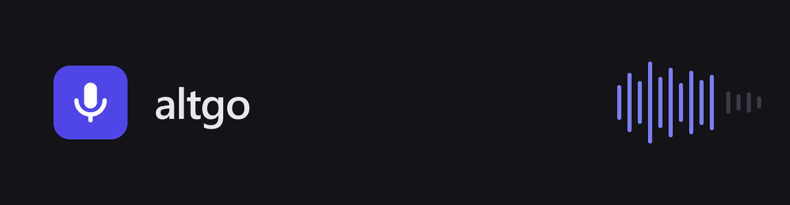

# altgo



[](https://github.com/ouyangjiahong26/altgo/actions/workflows/ci.yml)
[](https://ouyangjiahong26.github.io/altgo/)
[](https://github.com/ouyangjiahong26/altgo/releases)
[](LICENSE)

altgo 是桌面语音转文字工具。按住触发键（默认右 Alt）说话，松开后自动完成录音、转写与可选润色，结果写入系统剪贴板，并在屏幕底部悬浮窗中单行展示。

转写引擎二选一。本地引擎内嵌 sherpa-onnx，可选 SenseVoice（多语种自动检测）或 FireRedASR2 CTC（中英混说更强），离线可用。在线引擎接入云端 ASR，默认 MiMo，无需下载模型，需填 API Key。

altgo 覆盖 Linux 与 Windows 的 x86_64 与 arm64 四个组合：Linux 支持 Ubuntu 22.04+ 的 x86_64 与 aarch64，Windows 支持 10+ 的 x86_64 与 arm64。macOS 暂不支持。

- [在线文档](https://ouyangjiahong26.github.io/altgo/)
- [Releases 下载](https://github.com/ouyangjiahong26/altgo/releases)
- [问题反馈](https://github.com/ouyangjiahong26/altgo/issues)

## 功能

### 录音与转写

- 按住右 Alt 说话，松开自动转写。触发键可在设置中更改。
- 连续模式：双击触发键进入连续录音，再单击停止，适合较长发言。
- 本地转写：内嵌 sherpa-onnx，模型常驻加载，可在设置页下载与管理。可选 SenseVoice、SenseVoice 粤语增强或 FireRedASR2 CTC。
- 在线转写：云端 ASR，默认 MiMo，无需下载模型，需填 API Key。


### 润色与输出

- LLM 润色（可选）：四档强度，支持 OpenAI 兼容协议与 Anthropic Messages API，内置多家提供商预设，也可完全离线使用本机模型。
- 结果写入剪贴板，并在屏幕底部悬浮窗以单行展示。
- 转写中悬浮窗显示旋转环与进度线。


### 历史与桌面集成

- 本地转写历史：查看、复制、复制原文、删除、清空、重新润色。
- 自动输入到光标位置（仅 Windows，默认关闭）。
- 自动检查更新：启动时静默检查，设置页可手动检查并在独立窗口查看更新说明。
- 托盘图标：显示主窗口或退出应用。
- 外观可调：深浅配色跟随系统或手动指定，字体大小与窗口尺寸各三档。
- 只保存文本，从不保存音频。

## 安装

### Linux

安装前把当前用户加入 `input` 组，否则无法读取键盘设备。随后注销重新登录：

```bash
sudo usermod -aG input "$USER"
```

从 [Releases](https://github.com/ouyangjiahong26/altgo/releases) 下载对应架构的 `.deb`、`.rpm` 或 `.AppImage`，然后安装或直接运行：

```bash
sudo apt install ./altgo_*.deb
# 或
sudo dnf install ./altgo-*.rpm
# 或
chmod +x altgo_*.AppImage && ./altgo_*.AppImage
```

`.deb` 与 `.rpm` 已声明覆盖桌面集成、音频、剪贴板与 `evtest` 的依赖。AppImage 不自动解析依赖，缺库时按运行时的报错补装。Wayland 会话需确保已安装 `evtest`，且当前用户可读 `/dev/input/event*`。

重新登录后启动 altgo，在设置页完成转写配置。

### Windows

从 [Releases](https://github.com/ouyangjiahong26/altgo/releases) 下载与设备架构对应的 `*-setup.exe`（NSIS 安装器），双击安装，然后从开始菜单启动 altgo，在设置页完成转写配置。x64 与 arm64 按设备架构选择对应包。

## 快速开始

启动应用后，在设置页完成：

1. 选择转写引擎。本地引擎需先下载模型，在线转写需填 API Key。
2. 按需设置润色档位与润色服务。
3. 确认触发键，默认右 Alt。
4. 点击保存。

按住右 Alt 开始录音。松开后依次完成转写、润色（可选）、写入剪贴板，并在悬浮窗显示结果。转写历史默认保存在 `~/.config/altgo/history.json`，只保存文本。

## 文档

- [在线文档](https://ouyangjiahong26.github.io/altgo/)：快速上手、配置、使用、架构与 FAQ
- [`CONTRIBUTING.md`](CONTRIBUTING.md)：开发环境、构建、测试、CI 与发版
- [`docs/architecture.md`](docs/architecture.md) 与 [`AGENTS.md`](AGENTS.md)：系统架构与核心模块
- [`docs/README.md`](docs/README.md)：仓库内文档索引
- [`CHANGELOG.md`](CHANGELOG.md)：版本历史

## Code signing policy

Windows installers (`*-setup.exe`) use free code signing provided by SignPath Foundation. After onboarding is complete, every release will be signed with the same identity.

> Free code signing provided by SignPath.io, certificate by SignPath Foundation

- Committers and reviewers: [ouyangjiahong26](https://github.com/ouyangjiahong26)
- Approvers: [ouyangjiahong26](https://github.com/ouyangjiahong26)
- Privacy policy: [Privacy Policy](https://ouyangjiahong26.github.io/altgo/docs/privacy)
- Onboarding status, requirements and release process: [`docs/code-signing.md`](docs/code-signing.md)

After signing is enabled, Windows SmartScreen and UAC prompts will show SignPath Foundation as the publisher. Reputation builds up over clean installs, so the first downloads of a new release may still show a warning.

### 中文

Windows 安装包使用 SignPath Foundation 提供的免费代码签名，接入完成后所有 Release 都使用同一签名身份。签名后 SmartScreen 与 UAC 提示会显示 SignPath Foundation 为发布者，新版本首次下载仍可能提示。隐私政策见[隐私政策](https://ouyangjiahong26.github.io/altgo/docs/privacy)，接入状态、申请条件与发布流程见 [`docs/code-signing.md`](docs/code-signing.md)。

## 许可证

[MIT License](LICENSE)
